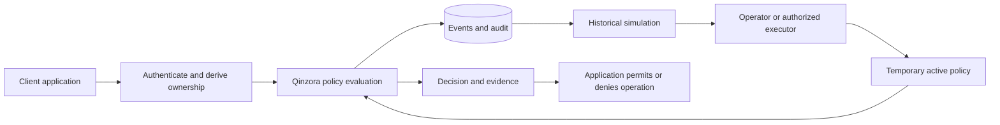

# Qinzora

[](https://github.com/vinidutraa/qinzora/actions/workflows/ci.yml)
[](pyproject.toml)
[](LICENSE)

**Evaluate API policies, inspect evidence, and simulate historical impact before enforcement.**

[Português brasileiro](https://github.com/vinidutraa/qinzora/blob/main/README.pt-BR.md) · [Documentation](https://github.com/vinidutraa/qinzora/blob/main/docs/index.md) · [Releases](https://github.com/vinidutraa/qinzora/releases) · [Contributing](https://github.com/vinidutraa/qinzora/blob/main/CONTRIBUTING.md)

Qinzora is an open-source Python service for API security policy evaluation, rate limiting, tenant isolation and incident monitoring. Applications send structured events and enforce the decisions it returns. Historical simulation helps operators review a proposed policy before activating it for a limited time.

## Why Qinzora?

Changing access policies without evidence can disrupt legitimate requests. Qinzora brings observation, historical replay and temporary enforcement into one inspectable workflow. It separates deterministic access decisions from optional AI explanations and policy proposals. It is a backend designed for integration through HTTP/JSON or a Python SDK; no dashboard is required. These are design choices, not claims of uniqueness or superiority over other tools.

## Implemented features

- Candidate policies observe traffic without blocking; active policies expire or can be revoked.
- Rate limits count attempts by service, route and subject, including denied attempts.
- Tenant isolation checks trusted identity and resource ownership supplied by the application.
- Error bursts and latency provide monitoring evidence for completed responses.
- Historical replay reports affected events and impact by application-provided labels.
- Scoped manager/collector keys, rotation, account isolation, audit and event export.
- Synchronous/asynchronous Python clients, CLI, Docker Compose and independent-process HTTP demos.
- Optional bounded AI administration: typed proposals, explicit authority, fresh replay and transactional execution.
- Experimental contract-based cached-read continuity; see [status and limits](https://github.com/vinidutraa/qinzora/blob/main/docs/continuity.md).

## Architecture



Python 3.12+, FastAPI, Pydantic, HTTPX and SQLite form the runtime. Pytest and Ruff support verification. Qinzora runs separately from the host application; storage currently supports one service instance with serialized transactions.

## Install and run a demonstration

Clone the repository or use **Code → Download ZIP**:

```sh
git clone https://github.com/vinidutraa/qinzora.git
cd qinzora
python -m venv .venv
```

Windows PowerShell, without activating the environment:

```powershell
.venv\Scripts\python.exe -m pip install --require-hashes -r requirements-lock.txt
.venv\Scripts\python.exe -m pip install --no-deps .
.venv\Scripts\qinzora.exe demo --present
```

Linux/macOS:

```sh
.venv/bin/python -m pip install --require-hashes -r requirements-lock.txt
.venv/bin/python -m pip install --no-deps .
.venv/bin/qinzora demo --present
```

The demo starts Qinzora and a fictional documents API as independent processes. It checks same-tenant access, observation of cross-tenant attempts, simulation, activation, denial, revocation, rate limiting, unavailability and recovery. It uses synthetic data and temporary storage, cleans up its processes, and returns `"passed": true` when its checks succeed. No AI, Docker or manual credential setup is required.

Alternatively, install a wheel from [GitHub Releases](https://github.com/vinidutraa/qinzora/releases) with `python -m pip install PATH_TO_WHEEL.whl`. **No PyPI publication is claimed:** do not assume `pip install qinzora` is available. Package-name ownership and publication remain external steps.

Existing 0.3.21 release wheels predate the experimental continuity and documentation changes in this 0.4.0 checkout. Install the current source to try those changes; no older release asset has been overwritten.

Subsequent commands abbreviate the virtual environment's `python` and `qinzora` executables.

## Run a persistent service

```text
qinzora init
qinzora serve
```

`init` creates a private `.env` with a random administrator token and database path, refusing to overwrite an existing file. The default address is `http://127.0.0.1:8765`; interactive API reference is at `/docs`, OpenAPI at `/openapi.json`, readiness at `/healthz`. Keep `.env` outside Git. Provision an integration account and retain its manager and collector keys securely; see [API reference](https://github.com/vinidutraa/qinzora/blob/main/docs/api.md).

## Python integration

The SDK does not require FastAPI. This helper accepts an `Event` with server-verified identity and resource ownership:

```python
from qinzora.client import QinzoraClient, QinzoraUnavailable
from qinzora.models import Event


def evaluate_access(base_url: str, collector_key: str, event: Event) -> bool:
    with QinzoraClient(base_url, collector_key) as guard:
        try:
            decision = guard.decide(event)
        except QinzoraUnavailable:
            raise  # Return unavailability; do not perform the protected operation.
        return decision["allowed"]
```

Reuse the client for a web application's lifecycle. A false result must prevent the operation; a true result still requires the application's own authorization. `AsyncQinzoraClient` provides async equivalents. See [SDK and failure handling](https://github.com/vinidutraa/qinzora/blob/main/docs/sdk.md) and the executable [documents example](https://github.com/vinidutraa/qinzora/blob/main/examples/documents_api.py).

## Policy lifecycle

Create a candidate with the manager key, for example:

```json
{"name":"Document isolation","service":"documents","route":"/documents/{id}","kind":"tenant_isolation","ttl_seconds":900}
```

`POST /v1/events` records an observation; `POST /v1/decisions` records and evaluates a pre-operation attempt. **Do not submit the same attempt to both endpoints.** Reuse `event_id` only when explicitly retrying the same request and mode.

Call `POST /v1/policies/{id}/simulate`, review the snapshot and affected labels, then activate with `POST /v1/policies/{id}/activate` and `{"simulation_id":"RETURNED_ID","acknowledge_impact":true}`. Activation requires a matching simulation less than 15 minutes old with relevant events. Expiration or `/revoke` stops enforcement.

| Policy | Purpose | Can deny after activation? |
| --- | --- | --- |
| `rate_limit` | Attempts in a time window | Yes |
| `tenant_isolation` | Missing or mismatched tenant context | Yes |
| `error_burst` | Concentration of response status ≥400 | No, observation only |
| `latency` | Observed latency above a threshold | No, observation only |

Replay evaluates retained metadata, not real operations. It does not discover correct permissions or prove future absence of false positives. [Policy semantics](https://github.com/vinidutraa/qinzora/blob/main/docs/policies.md).

## Optional AI

Incident explanations use an optional Ollama model configured through `QINZORA_OLLAMA_URL` and `QINZORA_OLLAMA_MODEL`. Canonical evidence remains available if inference fails. Commentary is advisory and separate from deterministic decisions.

Administration is separate: `qinzora manage --config FILE.json` proposes a typed plan; `--execute` applies it only within configured authority. `qinzora watch --config FILE.json --execute` monitors evidence changes. The example does not grant enforcement by default. These operations cannot execute arbitrary shell commands or modify external applications. [AI configuration and limits](https://github.com/vinidutraa/qinzora/blob/main/docs/ai.md).

## Docker

After `qinzora init`, with Docker Engine and Compose:

```text
docker compose up --build -d
docker compose ps
docker compose down
```

Compose publishes to loopback, retains SQLite in `qinzora-data`, uses a non-root user and a read-only root filesystem with explicit writable paths. These settings do not replace TLS or access controls. [Deployment and backup](https://github.com/vinidutraa/qinzora/blob/main/docs/deployment.md).

## Tests

```text
python -m pip install --require-hashes -r requirements-dev-lock.txt
python -m pip install --no-deps -e .
python -m pytest -q
python -m ruff check src tests examples scripts
python -m ruff format --check src tests examples scripts
python scripts/http_smoke.py
```

CI covers Windows/Linux with Python 3.12 and 3.14 and a Linux Docker smoke test. A passing demo verifies its scenarios, not arbitrary production workloads. [Validation procedures](https://github.com/vinidutraa/qinzora/blob/main/docs/validation.md).

## What Qinzora does not do

- Intercept traffic automatically, replace authentication/authorization or infer resource ownership.
- Provide complete application protection, an edge firewall or a distributed rate limiter.
- Provide high availability, durable integration queues or tamper-proof audit storage.
- Guarantee correct AI proposals solely because they match a schema.

Replay is bounded to 100,000 retained events/account. Client keys have a control API limit of 600 requests/minute; request bodies are limited to 1 MiB and policies to 100/account. Pruning changes replay and rate history. Credentials, deployment configuration and callbacks remain operator responsibilities. See [security](https://github.com/vinidutraa/qinzora/blob/main/docs/security.md) and [troubleshooting](https://github.com/vinidutraa/qinzora/blob/main/docs/troubleshooting.md).

## Documentation and contribution

[Documentation index](https://github.com/vinidutraa/qinzora/blob/main/docs/index.md) · [Architecture](https://github.com/vinidutraa/qinzora/blob/main/docs/architecture.md) · [CLI](https://github.com/vinidutraa/qinzora/blob/main/docs/cli.md) · [Distribution](https://github.com/vinidutraa/qinzora/blob/main/docs/distribution.md) · [History disclosure](https://github.com/vinidutraa/qinzora/blob/main/docs/history.md) · [Portuguese guides](https://github.com/vinidutraa/qinzora/blob/main/docs/pt-BR/index.md)

The documentation site can be built locally. A configured site URL does not prove public deployment. See [CONTRIBUTING.md](https://github.com/vinidutraa/qinzora/blob/main/CONTRIBUTING.md). Licensed under the [MIT License](https://github.com/vinidutraa/qinzora/blob/main/LICENSE).
