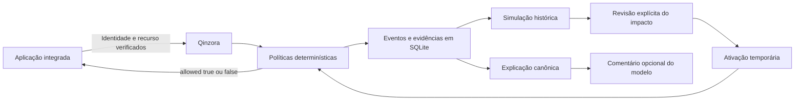
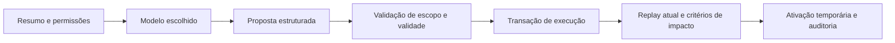

# Arquitetura e decisões

- **Fluxos separados:** `/events` observa; `/decisions` avalia antes da operação. A aplicação aplica a decisão e mantém sua autorização própria.
- **Mesmo motor:** replay, referência de testes e avaliação dos contadores SQL usam `evaluate_counts`. A otimização evita carregar e desserializar todo o histórico recente por requisição. Testes comparam os resultados das três formas de avaliação.
- **Concorrência:** transações SQLite `BEGIN IMMEDIATE` serializam decisões e protegem contadores/idempotência. Esse desenho prioriza consistência local e limita escala. O limite inclui tentativas negadas.
- **Migração:** schema v2 adiciona o status HTTP indexável aos eventos antigos, preservando seu conteúdo. A migração é testada. Eventos de decisão anteriores à operação não representam a resposta final do software integrado.
- **Explicações consultivas:** motivos e contagens têm explicação canônica fixa. O modelo produz apenas um comentário separado, sujeito a erro. Falha ou timeout não muda permissões.
- **Falhas:** SDK rejeita respostas inválidas, erros de transporte e HTTP de erro. A aplicação de exemplo retorna 503 sem documento quando o serviço está indisponível. Após reinício, a integração reutiliza o banco persistido.
- **Auditoria e privacidade:** chaves de cliente armazenadas com hash; eventos sem bodies/queries. IDs devem ser opacos e contexto deve vir do servidor. Auditoria local não oferece garantia de inviolabilidade.
- **Projeto gratuito:** controle de capacidade e habilitação é técnico. Não há integração de pagamento.

O verificador de regressões trabalha com contratos declarados de rotas. Não prova que a implementação cumpre o contrato; isso requer testes do software integrado.

## Limite entre aplicação e transporte

A camada `service` sinaliza falhas com `ApplicationError`, sem importar FastAPI. O adaptador HTTP traduz os códigos de aplicação para as respostas existentes (404, 409, 413 e 429). Outros adaptadores podem tratar a mesma falha sem depender de HTTP. A camada de aplicação utiliza o protocolo `Repository`; `SQLiteRepository` implementa a persistência, dentro de uma transação controlada pelo adaptador. Criar, simular, ativar e revogar políticas são operações reutilizáveis sem HTTP. Autenticação, administração de contas e exportação ainda ficam no adaptador HTTP/SQLite.

## Persistência e clientes

O armazenamento rejeita atualização de um identificador pertencente a outra conta ou categoria de objeto. Migrações executam DDL e transformação de dados na mesma transação, sem `executescript` (que confirma a transação implicitamente). Versões de schema desconhecidas são rejeitadas; não há downgrade automático.

O cliente Python oferece variantes síncrona e assíncrona com o mesmo contrato de decisão. A validação e a tradução de erros de transporte são compartilhadas pelo contrato, sem retentativas automáticas. Cancelamento não constitui rollback remoto. O teste HTTP verifica negação e idempotência pelo cliente assíncrono contra um servidor real local.

O replay rejeita horários sem fuso ou fora da ordem de ingestão. A ativação rejeita relatórios futuros ou com mais de 15 minutos. Isso evita aceitar relatórios inconsistentes após mudanças do relógio, mas não equivale a garantir sincronização de relógios em um sistema distribuído.

Na ingestão, o serviço compara o horário atual ao último evento retido da conta e recusa uma nova decisão se o relógio retrocedeu. Repetições idempotentes são retornadas antes dessa verificação. O índice `(tenant, seq)` atende à consulta. A proteção cobre os eventos retidos; não fornece histórico de relógio após remoção de todos os eventos.

## Controlador de administração

O pacote `administration` separa contratos de proposta/permissão, montagem do contexto e execução. `StructuredModel` é a porta de inferência; `RepositoryFactory` fornece transações de uma conta autorizada. O modelo recebe uma cópia do resumo e não pode mudar o snapshot guardado pelo controlador. Não há transação aberta durante inferência.

A aplicação hospedeira autoriza a conta antes de criar a fábrica; o adaptador `account_transaction` verifica sua existência e habilitação em cada transação. Criação, replay, ativação/revogação e resultado do plano compartilham commit/rollback. O controlador não representa um agente com acesso arbitrário ao sistema. Veja [Administração](ADMINISTRACAO.md) para os contratos e limites operacionais.
