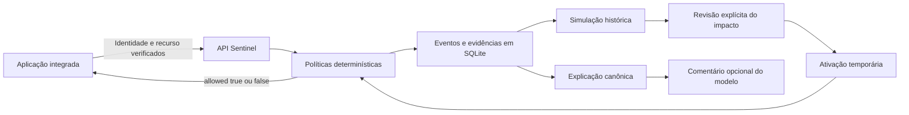

# Arquitetura e decisões

- **Fluxos separados:** `/events` observa; `/decisions` avalia antes da operação. A aplicação aplica a decisão e mantém sua autorização própria.
- **Mesmo motor:** replay, referência de testes e avaliação dos contadores SQL usam `evaluate_counts`. A otimização evita carregar e desserializar todo o histórico recente por requisição. Testes comparam os resultados das três formas de avaliação.
- **Concorrência:** transações SQLite `BEGIN IMMEDIATE` serializam decisões e protegem contadores/idempotência. Esse desenho prioriza consistência local e limita escala. O limite inclui tentativas negadas.
- **Migração:** schema v2 adiciona o status HTTP indexável aos eventos antigos, preservando seu conteúdo. A migração é testada. Eventos de decisão anteriores à operação não representam a resposta final do software integrado.
- **IA sem autoridade:** motivos e contagens têm explicação canônica fixa. O modelo produz apenas um comentário separado, sujeito a erro. Falha ou timeout não muda permissões.
- **Falhas:** SDK rejeita respostas inválidas, erros de transporte e HTTP de erro. A aplicação de exemplo retorna 503 sem documento quando o serviço está indisponível. Após reinício, a integração reutiliza o banco persistido.
- **Auditoria e privacidade:** chaves de cliente armazenadas com hash; eventos sem bodies/queries. IDs devem ser opacos e contexto deve vir do servidor. Auditoria local não oferece garantia de inviolabilidade.
- **Projeto gratuito:** controle de capacidade e habilitação é técnico. Não há integração de pagamento.

O verificador de regressões trabalha com contratos declarados de rotas. Não prova que a implementação cumpre o contrato; isso requer testes do software integrado.
