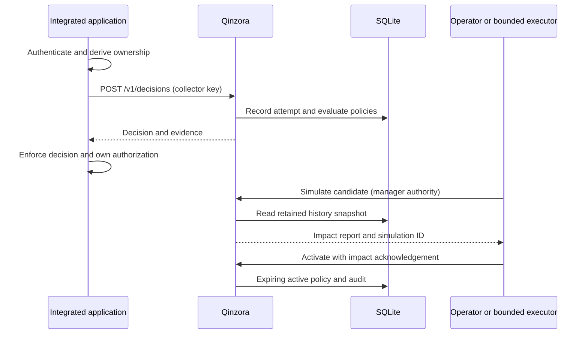

# Architecture

The host application authenticates users, derives resource ownership on the server, asks Qinzora for a decision, applies its own authorization, and permits or denies the operation. A client-supplied tenant header is not trustworthy context.

FastAPI exposes HTTP/JSON; Pydantic validates contracts. The engine computes deterministic findings. Services coordinate lifecycle, replay and evidence. A repository protocol separates domain operations from SQLite, with account-scoped transaction factories.

The SDK validates transport responses; it does not grant access on invalid responses. Structured models propose typed plans. The administrator separately validates authority, scope, expiry and fresh replay before committing atomically. Its monitor persists checkpoints and a per-account lease. Inference occurs outside write transactions.

SQLite writes/replay are serialized. This is a single-instance design, not distributed storage or HA. Transaction rollback covers database actions, not operations already executed externally. Local audit is inspectable, not tamper-proof.
